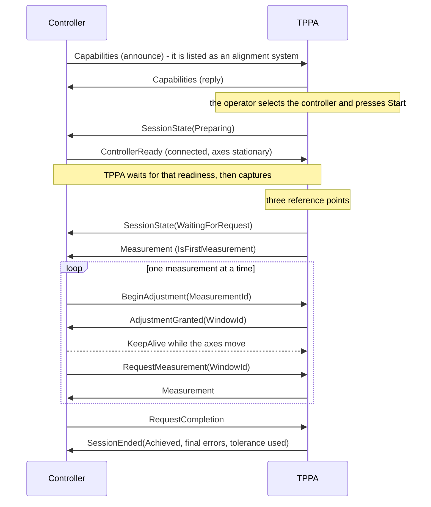

# External correction (three point polar alignment driven by another plugin)

This document is the contract between the Three Point Polar Alignment plugin (TPPA) and an external
controller plugin that moves the mount axes, for example the MLAstro RPA plugin. TPPA keeps measuring,
the external controller keeps adjusting.

External correction is **selected, not detected**: a controller that announces itself on the message
broker shows up in TPPA's Polar Alignment System list, next to `None`, `UPAS` and `OAPA`, and the
external step of the run starts only while that entry is selected. TPPA never connects to a controller
on its own, and a run without that selection is the stock run, unchanged.

## 1. Responsibility split

| | TPPA | External controller |
|---|---|---|
| Three reference points, plate solving, polar error estimation | yes | |
| Session and camera lifecycle, slew, guiding, TPPA UI | yes | |
| Deciding *when* TPPA takes the next exposure | no, only on request | yes |
| Reporting its hardware as connected and stationary | no, TPPA only reads what the controller reports | yes |
| Correction strategy (safety factor, axis mode, overshoot, backlash) | | yes |
| Hardware movement | | yes |
| Ending the session | yes, it is the only owner of the session | requests it |

Two different "estimate" mechanisms exist in TPPA and only one of them is involved here:

* `ContinuousPolarErrorEstimator` still runs in external mode. It produces the numbers published in a
  `Measurement`.
* `AutomatedAdjustmentController` is **not** used. TPPA never nudges the axes itself in external mode,
  and it never captures on its own either: the external step publishes the measurement of the run's own
  correction loop and waits for the controller's single answer to it.

## 2. Topics

Both topics carry an `IMessage` whose `Content` is the JSON of the same envelope, so the two plugins
never need to share a type or an assembly.

| Topic | Published by | Subscribed by |
|---|---|---|
| `PolarAlignmentPlugin_PolarAlignment_ExternalEvent` | TPPA | controller |
| `PolarAlignmentPlugin_PolarAlignment_ExternalCommand` | controller | TPPA |

The pre-existing topics (`..._Progress`, `..._AlignmentError`, `..._PauseAlignment`,
`..._ResumeAlignment`) and their messages are unchanged and keep working in external mode.

## 3. Envelope

Every message carries:

| Field | Meaning |
|---|---|
| `Version` | Interface version. A receiver with a different value ignores the message. |
| `SessionId` | Session the message belongs to. Session scoped messages are ignored by other sessions. |
| `CommandId` | Unique per command. Repeating a `CommandId` is idempotent: TPPA does not act twice. |
| `ReplyTo` | `CommandId` this message answers, when it is a reply. |
| `SequenceNumber` | Monotonic per sender, for diagnostics. |
| `Kind` | Message kind, see below. |
| `IntendedRecipient` | Address of the receiver. TPPA accepts `TPPA` (or an empty field) and drops anything else. TPPA addresses the controller with the name that controller announced; a controller that announced no name is addressed as `MLAstroRPA`. The field is kept for wire compatibility: *which* run a message belongs to is decided by the broker identity (`IMessage.SenderId`) that the run bound when it started, and a message from any other controller is dropped with one log line. A controller of an older build that identifies no sender is not filtered. |
| `Payload` | Kind specific JSON object. |

## 4. Kinds

| Kind | Direction | Purpose |
|---|---|---|
| `Capabilities` (announce) | controller → TPPA | The controller announces itself: it is listed as an alignment system while its announcements keep arriving. The `Controller` value is the address TPPA uses for it. TPPA answers even when no session is running. An announce never takes a running session over. |
| `Capabilities` (reply) | TPPA → controller | Interface version, TPPA version, supported kinds, tolerance, heartbeat / silence timeout / ready timeout / session timeout / grace / stop ack timeout, calculation mode, current session. |
| `SessionState` | TPPA → controller | Heartbeat (every `HeartbeatMs`) and state change: `Preparing`, `Measuring`, `WaitingForRequest`, `WindowOpen`, `Verifying`, `Ended`, plus a reason. The controller adopts the `SessionId` from `Preparing`. |
| `ControllerReady` | controller → TPPA | Its hardware is connected and its axes are stationary. Sent again whenever that changes and when TPPA asks (after the sweep, after a resume). TPPA reads it at the points where it decides: before the reference frames, after a resume, and while it waits for a measurement answer. A controller that never reported readiness counts as not connected. |
| `Measurement` | TPPA → controller | One polar error sample, see the field list below. Publishing it opens the one interaction the controller has to answer. |
| `BeginAdjustment` | controller → TPPA | "I want to hold the capture while I move." Granted only for the measurement that is pending and usable; a repeat while a window is open is answered with that same window. |
| `AdjustmentGranted` | TPPA → controller | Capture window granted, with `WindowId`, `MaxWindowMs`, `SilenceTimeoutMs`. TPPA drops the answer deadline of the measurement here. |
| `RequestMeasurement` | controller → TPPA | "I moved, take the next sample." Accepted while this measurement's interaction is still open; refused when it names a window the run does not hold. |
| `RequestCompletion` | controller → TPPA | "I believe we are done" - TPPA verifies with its own policy before ending the run as achieved. |
| `KeepAlive` | controller → TPPA | Refreshes the silence watchdog while a window is held. It is not an answer. |
| `PauseRequested` | TPPA → controller | The operator paused or resumed the run. On pause TPPA ends the interaction it is waiting for (and its window), so the loop stands at its own pause check; the controller must stop a move in progress, must not start one, and answers the measurement it was holding. On resume TPPA waits for readiness again. |
| `StopRequested` | TPPA → controller | Stop and park, with a reason and an ack timeout. |
| `Stopped` | controller → TPPA | Acknowledgement, with a hardware stop status (`ok`, `unknown`, `fault`). |
| `Cancel` | controller → TPPA | The controller gives up on the session, with a reason: `UserStop` (stop pressed on the controller), `BrokerDisabled` (the broker was switched off in the plugin options), `Disconnect`, `FirmwareDisconnected` (serial or wireless firmware link lost), `SessionTimeout`, `ExternalLost`, `ControllerFault`. TPPA ends the run with that reason and shows it to the operator; `BrokerDisabled` also takes the controller out of the system list at once. |
| `Fault` | controller → TPPA | The controller cannot continue (hardware, link, repeated unusable measurements). TPPA treats it as a cancel carrying the same reason and detail. |
| `SessionEnded` | TPPA → controller | Last message of a session: reason, achieved, final errors, tolerance used, samples used, hardware stop status. |

### 4.1 `Measurement` fields

Only arcminutes are published: that is the unit TPPA itself works in, so the controller never
converts and never rounds differently from TPPA.

| Field | Notes |
|---|---|
| `MeasurementId`, `SessionId`, `WindowId`, `SampleIndex`, `IsFirstMeasurement`, `TimestampUtc` | bookkeeping |
| `Status` | `Valid`, `Unstable` (continuous estimate unstable) or `CaptureFailed` |
| `AzimuthErrorArcMin`, `AltitudeErrorArcMin`, `TotalErrorArcMin` | signed polar error in arcminutes, exactly the values TPPA shows in its own UI |
| `ToleranceArcMin` | tolerance TPPA is using |
| `ToleranceReached` | this single sample is at or below tolerance |
| `AutoFinishConditionMet` | TPPA's own finish condition (consecutive samples below tolerance) is met |
| `ConsecutiveBelowTolerance` | how many consecutive samples were below tolerance |
| `Northern` | hemisphere, needed to turn the signed errors into up/down moves |
| `ContinuousEstimation` | which calculation path produced the numbers |

The controller derives the correction direction itself, from the sign of the error and `Northern`:
a positive azimuth error means "move left" (negative "move right"), and a positive altitude error
means "move down" in the northern hemisphere and "up" in the southern one. These two rules are the
only place where TPPA's own display convention has to be reproduced outside TPPA.

## 5. Flow

## 6. One interaction at a time

The external step of a run holds exactly one pending interaction, and the loop that owns the camera and
the mount drives it (the step never captures, solves or publishes on its own).

| Pending interaction | Opened by | Answered by | Deadline |
|---|---|---|---|
| Adjustment | publishing a `Measurement` | `BeginAdjustment` (which grants a window), or directly `RequestMeasurement` / `RequestCompletion` | `SilenceTimeoutMs` |
| Completion | the controller granting a window | `RequestMeasurement` (next sample) or `RequestCompletion` (verify) | `SilenceTimeoutMs` + `GraceAfterSilenceMs` |

Rules:

1. A move announced for another measurement, a move planned from a measurement that was not usable, and
   an answer naming a window the run does not hold are **refused** with a log line, and the run keeps
   waiting.
2. A repeated `BeginAdjustment` while the window is open is answered with **the same window**, so a
   controller that announces twice does not open a second one.
3. An answer that arrives with **no** pending interaction is ignored with a log line, instead of being
   used for whatever the run happens to wait for next.
4. Every measurement gets a waiter of its own. A finished waiter is never reused, otherwise the answer of
   the previous measurement is handed out for the next one and the loop captures for ever.
5. `KeepAlive` and `ControllerReady` are never an answer, but they keep a window alive.

## 7. Deadlines

The protocol values are fixed constants in the plugin. They are published in the `Capabilities` reply so
the controller never has to hard code them:

| Value | Fixed value |
|---|---|
| Heartbeat: `SessionState` interval, and the interval the controller has to keep alive in | 2000 ms |
| Controller silence allowed while a capture window is open, and the time a controller has to answer a measurement | 15000 ms |
| Grace before a silent controller is treated as gone | 10000 ms |
| How long TPPA waits for `ControllerReady` before the reference frames | 30000 ms |
| Session safety limit, counting only the time outside capture windows | 1800 s |
| Stop acknowledgement timeout | 5000 ms |

## 8. Safety rules

1. **The capture window TTL is a silence timeout, not a total duration.** TPPA is not allowed to
   capture while the controller is moving, and a move chain can take minutes, so the watchdog only
   measures how long the controller has been quiet. The controller must therefore send a `KeepAlive`
   from an independent timer, never from the thread that is blocked inside a move.
2. **TPPA never ends a session because of the measured error in external mode.** Reaching the
   tolerance only sets `ToleranceReached` / `AutoFinishConditionMet`; the controller decides to call
   `RequestCompletion`, and TPPA verifies with its own two-in-a-row condition before ending as achieved.
3. **Closing a window is not ending a session.** When the controller goes silent, TPPA closes the
   window, publishes `SessionState(SilenceTimeout)` and keeps the session open. Only after the grace
   period does it end the session as `ExternalLost`.
4. **A controller that goes quiet does not hand the run back.** Silence does not prove that the
   alignment hardware stopped, so a controller that is lost - while the external step is active, while
   it is bringing its hardware up, or while the reference frames are being measured - cancels the run
   with its reason; TPPA never continues with its own correction loop. The operator starts the
   alignment again.
5. **The controller and its hardware have to be ready before the three reference frames.** The run waits
   for that readiness for the readiness timeout and ends with `NoControllerReady` (one error, no
   captures) when it never comes, so the frames that model the whole run are never captured with axes
   that are still turning.
6. **A session time limit always applies.** It counts only the time the controller is *not* holding a
   window, so a long move chain cannot trip it. On expiry TPPA sends `StopRequested(SessionTimeout)`
   and expects a `Stopped` acknowledgement within the ack timeout.
7. **No unbounded waits.** An answer to a measurement, `ControllerReady`, window silence and stop
   acknowledgements all have deadlines; an expiry produces a `SessionEnded` with a reason.
8. **No periodic self-triggered capture.** TPPA captures only on request - the controller's answer to a
   measurement, or its own loop between two answers.

## 9. When a controller is not there

| Moment | Behaviour |
|---|---|
| No controller selected | The stock code path runs, unchanged. |
| `External` selected but the controller is not listed, or the alignment tolerance is zero | TPPA logs and warns, and runs its normal correction loop. |
| Before the reference frames: no readiness within the readiness timeout | The run ends with `NoControllerReady` (one error, no captures). |
| While the three reference points are measured, or while the controller is still bringing its hardware up: the controller stops answering | The run is cancelled with `ExternalLost` and an error that asks to start the alignment again. The hand-over either hands the run over or ends it - it never falls back to the normal correction loop. |
| During the external step: the controller cancels, reports a fault or stays silent past the grace period | The run is cancelled with that reason and reported to the operator; TPPA does not fall back to its own correction loop. |

## 10. Required controller behaviour

1. Bring the hardware link up when the run starts (`SessionState(Preparing)`), not after the sweep:
   TPPA asks for readiness before the reference frames, and a state of its own for the link is part of
   that answer (`HardwareConnected`, `HardwareReady`).
2. Report readiness again whenever it changes, and answer `StopRequested` within the announced ack
   timeout.
3. Leave the alignment system on `None` and `Do automated adjustments` off on the TPPA side; TPPA must
   not move anything by itself while the external step is active.
4. Expect one window per measurement: a repeated `BeginAdjustment` gets the same window back, an answer
   for a window that was already closed is refused, and a `KeepAlive` has to carry the window it keeps
   alive.
5. Stay inside the silence watchdog while holding a window, and never assume TPPA will end the run on
   its own.
6. Continue straight from the first measurement: there is no hand-over pause any more, pause follows
   TPPA's own "Auto pause" setting, and after a resume the run waits for readiness again.
7. Say goodbye when the broker is switched off (`Cancel` with `BrokerDisabled`): the entry leaves the
   system list at once instead of after the presence window, and the selection clears with it.
8. Read every tunable value from the `Capabilities` reply instead of hard coding it.

## 11. Tests

`NINA.Plugins.PolarAlignment.Test/BridgeControllerRunTest.cs` covers the contract without a camera or
mount: the single pending interaction (one waiter per measurement, an idempotent grant, a refused move
for a stale or unusable measurement, a refused answer for another window), keep-alive and window
expiry, a silent controller that ends the run as `ExternalLost`, the answer deadline of a controller
that never answers, pause ending the pending interaction, owner binding and the controller registry
(the list, the goodbye of a controller that switches its broker off, a second controller that cannot
take a running run over), the session states, the stop acknowledgement and the JSON round trip.

There is no simulator in the plugin: the reference controller is the MLAstro RPA plugin (its
`MLAstroRPA-broker/Broker/BridgeRunner.cs`).
